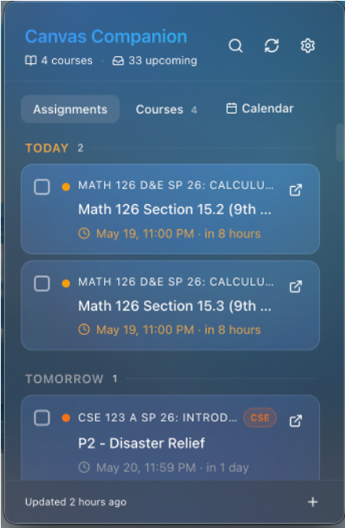
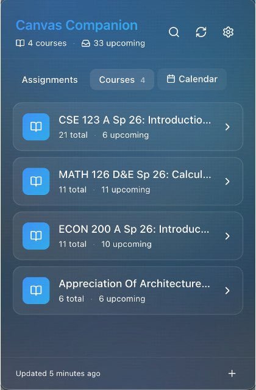
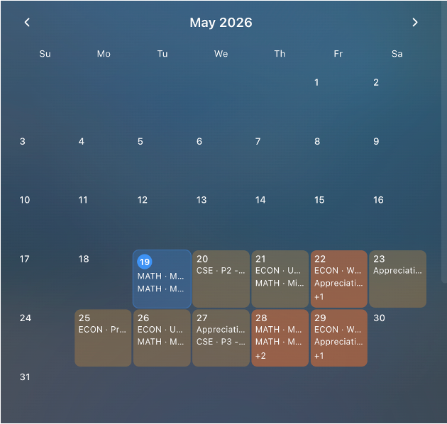

# Canvas Companion

A macOS menu bar app that shows your Canvas LMS deadlines the moment you open your laptop. No browser tab, no login, no clicking around.

> **Project status: paused.** The app is feature-complete, but development has stopped. In September 2026, UW IT stopped issuing Canvas API tokens to students, which removed the data access the app depends on at UW. The code is public as a portfolio piece and a reference for anyone building on the Canvas API.

<p>
  
  
  
</p>

## Why I built it

Canvas hides your deadlines inside a browser tab. You have to go looking to find out what's due. Assignments get missed not because you forgot them, but because nothing reminded you at the right time.

Canvas Companion fixes that by living in the menu bar. Your workload is always one glance away, and native notifications fire before things are due.

## Features

- **Urgency buckets.** Assignments sorted into Overdue, Today, Tomorrow, This Week, and Coming Up.
- **Submission status.** Badges show what's submitted, graded, or overdue.
- **Native notifications.** Configurable lead times (24h, 2h, 30 min, 15 min), with a button that opens the assignment in Canvas.
- **Auto sync.** Refreshes on a timer, on wake from sleep, and on demand.
- **Personal tasks.** Add your own to-dos alongside Canvas items. Stored locally only.
- **Calendar view.** See your deadlines laid out by day.
- **Command palette and search.** Fuzzy search across assignments, plus full keyboard navigation.
- **Snooze.** Hide an assignment for an hour or until tomorrow morning.
- **Course colors.** Per-course color coding and visibility toggles.
- **Light and dark mode** with a frosted glass panel.
- **Five-step onboarding** and in-panel settings.
- **Runs quietly.** Starts at login, stays out of the Dock and app switcher, shows a badge count for items due today.

## Tech stack

| Area | Tools |
| --- | --- |
| App shell | Electron, Node.js |
| UI | React 18, TypeScript, Tailwind CSS v4, framer-motion |
| Build | Vite, electron-builder (.dmg) |
| Data | Canvas REST API and GraphQL, axios |
| Storage | keytar (macOS Keychain) for the token, electron-store for settings and cache |
| Other | node-cron, fuse.js, date-fns |

## Interesting problems I solved

**Click outside to close.** Electron's blur event can't tell "the user clicked outside" apart from "the user pressed Cmd-Tab." Every blur-based fix failed one way or the other. The working solution is an invisible full-screen window that sits behind the panel and catches clicks. It uses a data URL page and intercepts navigation in the main process, so it needed no extra build config.

**Notifications that don't double-fire.** Notifications are scheduled per deadline with timers, separate from the sync loop. Each one has a key built from the assignment ID, lead time, and due date. Fired keys are saved to disk, so restarting the app doesn't repeat notifications.

**Timezone bugs.** `new Date("2026-10-04")` gives UTC midnight, which is the previous evening in Pacific time. Personal task dates are parsed from their parts into local end-of-day instead.

**Window state decay.** After long idle periods, the panel window could get into a broken state. The app now rebuilds the window from scratch on the next open if it has been idle too long.

**Token security.** The Canvas token lives only in the macOS Keychain. It is never written to disk, never logged, and never sent to the UI process.

## Running it yourself

You'll need a Canvas instance that still lets you create a personal access token. Many schools do. UW no longer does.

**Requirements:** macOS 13 or later, Node.js 20.

```bash
git clone https://github.com/AaravChhabra13/Canvas-Dashboard-Mac.git
cd Canvas-Dashboard-Mac
npm install
npm run build
```

The packaged app ends up in the build output folder. It is unsigned, so the first time you open it, right-click the app and choose **Open** to get past Gatekeeper.

On first launch, onboarding asks for:

1. Your Canvas URL (for example `https://canvas.yourschool.edu`)
2. A personal access token, from Canvas > Account > Settings > Approved Integrations > New Access Token

Note: `npm run dev` only starts the UI with hot reload. It does not run the main process, so use a full build to test tray, sync, or notification behavior.

## Project structure

```
electron/
  main.ts            App lifecycle, tray, panel and backdrop windows, sync, notifications
  preload.ts         The only bridge between main and UI
src/
  renderer/
    Panel.tsx        Main panel: state, IPC wiring, keyboard nav
    components/      SettingsPanel, CalendarView, GroupedList, AddTaskForm, etc.
  lib/               Grouping and helper functions
  shared/types.ts    Types shared by main and UI
```

## What's next (if it comes back)

- Sanctioned OAuth 2.0 access through a university IT department, so students don't need to create tokens
- Split `main.ts` into separate tray, sync, notification, and IPC modules
- A native SwiftUI rewrite

## Author

Built by [Aarav Chhabra](https://github.com/AaravChhabra13), a student at the University of Washington.

Not affiliated with or endorsed by Instructure or the University of Washington.
